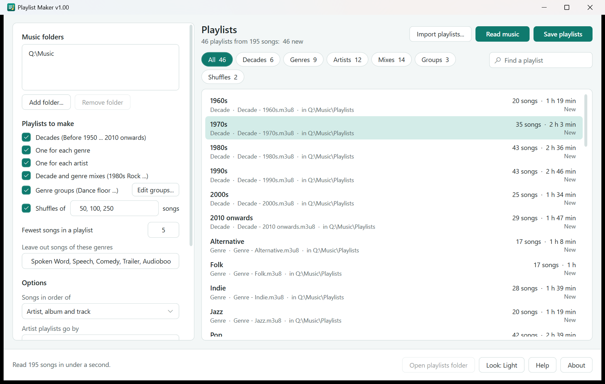
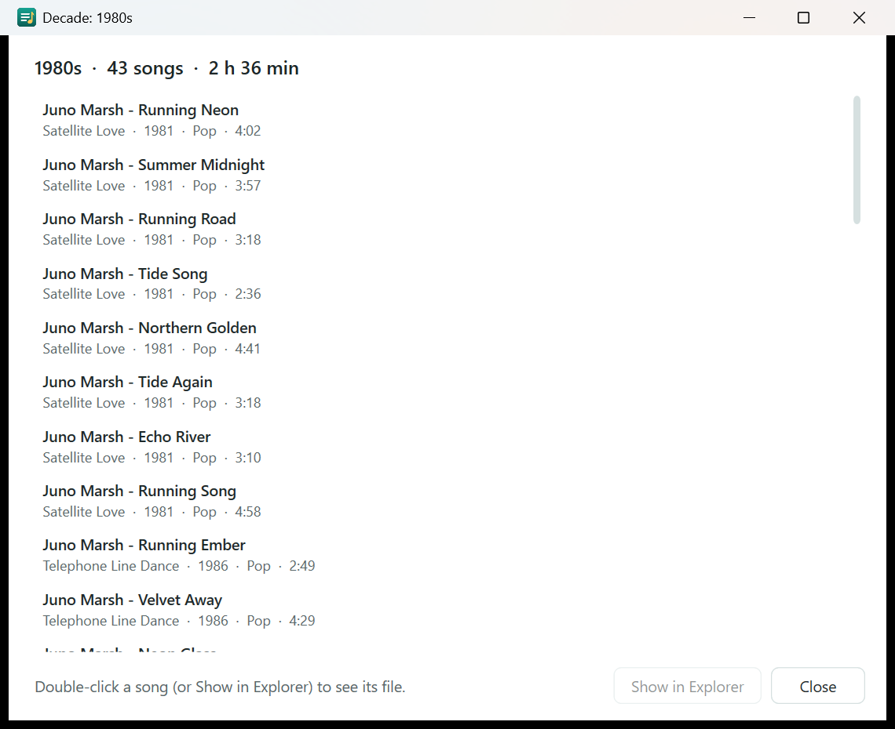

  

# Playlist Maker

Makes M3U playlists from your MP3s by decade, genre and artist, straight from their tags.

    

## ✨ Features

Playlist Maker is a PowerShell/WPF tool that reads the tags of the MP3s in your music folders and makes playlists from them, ready for any player that opens .m3u8 or .m3u files.

- **A playlist for each decade** (Before 1950, the 1950s to the 2000s, then 2010 onwards), **genre and artist**, and decade-and-genre **mixes** such as "1980s Rock". Tick the kinds you want, and leave out small ones with **Fewest songs in a playlist**.
- **Genre groups** such as *Dance floor*, *Chill*, *All Rock*, *Soul & Funk*, *Jazz & Swing* and *Ballads*, each putting several genres in one playlist. Edit them to suit your genres.
- **Shuffles** of as many songs as you like (10, 15, 25, 50, 100, 250 ...), a fresh pick each time you save.
- **Leave out genres** such as Spoken Word and Comedy, so they don't end up in your playlists.
- **Reads the tags itself**: ID3v2.2, 2.3 and 2.4, and ID3v1, with each song's running time. A remaster or best-of goes in the decade of its **original year** when the tag has one, and "feat." guests don't get artist playlists of their own.
- **Quick after the first time**: it remembers the tags it read, so the next read only opens new and changed files. Reading runs in the background, four files at a time, with a Stop button.
- **See before you save**: the list shows every playlist with its songs, running time and whether it is new, changed or up to date. Filter by kind, search by name, and double-click a playlist to see its songs.
- **Relative paths** by default, so the playlists keep working when the music folder is copied to a NAS, another PC or a phone. Or `/` paths for NAS and phone players, or full paths.
- **Tidy**: only playlists that changed are rewritten; ones it made before that are no longer wanted go to the Recycle Bin; a playlist with the same name made by something else is only replaced if you say so.
- **Import playlists you already have** (.m3u, .m3u8, .pls, .wpl, .zpl, .xspf). Their songs are found in your music even when the playlist was made on another PC, drive or NAS (by the same folders, or by artist and title), and they are saved with the others in your choice of paths and file type. Songs that can't be found are listed.
- **Never touches your music**: the MP3s are only read.
- **Missing tags**: the status bar says how many songs have no year, genre or artist, and clicking it lists them.
- Light and dark looks, Help and an About box.

## 🖼️ Screenshots

Double-click a playlist to see its songs:

## 📋 Requirements

- Windows 10 or 11.
- Windows PowerShell 5.1 (built into Windows) with .NET Framework 4.7.2 or later.
- MP3 files with tags (the more complete the tags, the better the playlists).

## 📦 Installation

1. Download `Playlist-Maker-v1.00.zip` from the [latest release](../../releases/latest) and unzip it wherever you like to keep it.
2. Double-click **Playlist Maker.cmd** in the unzipped folder. It makes a **Playlist Maker** shortcut there and in the Start menu, and starts the tool. From then on, use the shortcut, the Start menu or a pinned taskbar button.

Nothing is installed and no Windows settings are changed. The shortcut runs the script with PowerShell's execution policy bypassed for that run only.

**From the repo:** clone it and double-click **Start Playlist Maker.cmd**.

### Why no exe

Home tools used to ship as PS2EXE exes, and antivirus programs (ESET among them) kept flagging those exes as generic trojans by mistake. A plain script and a shortcut give the same one-click start without the false alarms, and you can read exactly what runs.

### Build a release

Double-click **Build.cmd** in the repo folder. It reads `build.json`, checks every script for syntax errors and that `$script:AppVersion` matches the newest `CHANGELOG.md` entry (if the version lives in a file of its own, add `"VersionFile": "src\\<file>.ps1"` to `build.json`; that file can call it `$script:<Name>Version`), runs PSScriptAnalyzer if it's installed, copies the release files into `..\Builds\Playlist Maker v<version>\`, zips that folder for the GitHub release, refreshes `..\Builds\Playlist Maker.lnk` (what the Home Launcher starts) and scans the result with ESET's command-line scanner if it's installed.

## 🚀 Usage

1. Start Playlist Maker (the shortcut, the Start menu, or **Playlist Maker.cmd**).
2. **Add folder...** for each folder of music (a NAS share works too). Everything under it is read.
3. Press **Read music**. The first read of a big collection takes a few minutes; later ones are quick.
4. Tick the playlists you want and pick the options on the left. The list updates as you go.
5. To bring in playlists you already have, press **Import playlists...** and pick them. They show under **Imported**; double-click one to see its songs or **Remove import**.
6. Press **Save playlists**. The first time, it asks which folder to put them in (**Choose...** changes it later; or pick **A folder inside each music folder** to give each music folder its own). **Open playlists folder** shows them.

Press **Read music** and **Save playlists** again whenever you add music: new playlists are added, changed ones updated and the rest left alone.

### Which paths to choose

| Paths | Written as | Use it when |
| --- | --- | --- |
| Relative (the default) | `..\Artist\Album\Song.mp3` | The playlists stay inside the music folder, on this PC or a copy of it elsewhere. |
| Relative, for NAS and phones | `../Artist/Album/Song.mp3` | A NAS media server or phone player reads the playlists. |
| Full paths | `C:\Users\You\Music\Artist\Album\Song.mp3` | Only this PC plays them, from anywhere. |

A song on a different drive from its playlist always gets a full path.

## ⚙️ Configuration

**Where settings live:** `%APPDATA%\Playlist Maker`, never inside the repo or a release folder. Everything is set in the window.

- `settings.json`: your music folders, the playlists to make, the options and the look.
- `tags.cache`: the tags read last time, so the next read is quick. Deleting it only makes the next read slower.
- `made.txt`: the playlists Playlist Maker has saved, so it knows which old ones it may tidy away.
- `kept.txt`: same-named playlists made by something else that you chose to keep.
- `imports.json`: the playlists you imported, as the songs they matched.
- `Playlist Maker.log`: reads, saves and anything that went wrong.

## 📝 Changelog

See [CHANGELOG.md](CHANGELOG.md).

## 📄 Licence

[MIT](LICENSE). Copyright (c) 2026 Jason Rhodes.

Created by Jason Rhodes, built with Claude (Anthropic).
